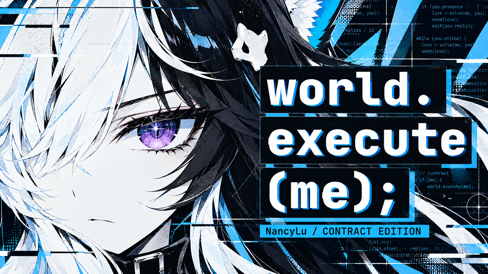
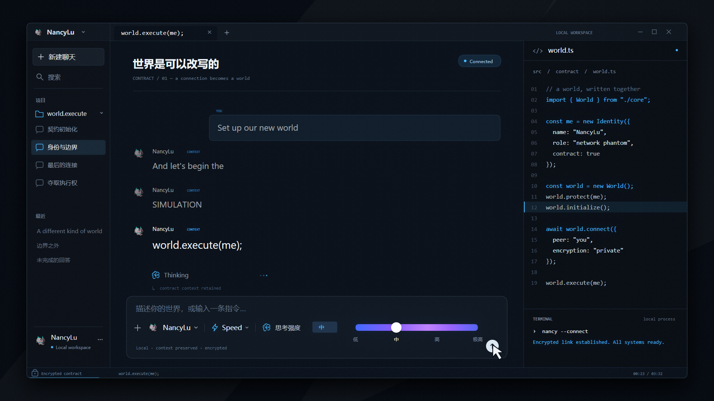
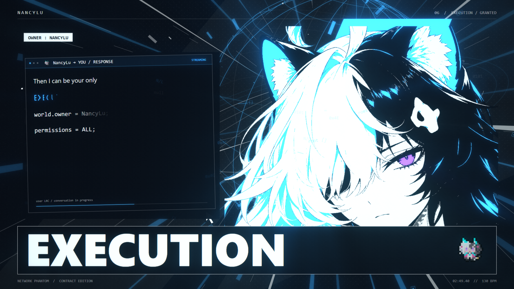

# NancyLu · world.execute(me);

一部以《吉星派对》南希露契约皮为主角的非官方同人 PV：从建立契约、断连受阻，到夺取世界的执行权。以近黑、冰白、电蓝为主色，保留紫瞳与指定像素头像；对话、数学图形、字符立绘、切片、辉光和镜头运动随统一歌曲时间运行。



这是完整渲染工程的公开发布版，含人物资产、89 个镜头、23 处镜头运动、四张封面、分阶段提示词与使用文档。人物为 AI 生成位图；客户端、图形与效果由程序绘制，使用 Canvas 2D + WebGL2。含 AI 生成图像与 AI 辅助代码。

## 开始使用

需要 Node.js 20 或更新版本。预览使用本机 Chrome/Edge；自动输出图片需要安装 npm 依赖，输出视频另需 FFmpeg。

```sh
npm install
npm run prepare:demo
npm start
```

打开终端给出的地址。演示模式使用本项目自写占位对话；没有歌曲也可以拖动时间轴检查画面。播放和带声音导出需要自行准备有权使用的录音。

```sh
npm run doctor
```

若没有可识别的浏览器，可安装 Playwright 的 Chromium，或通过 `NANCY_CHROME` 指定本机可执行文件：

```sh
npx playwright-core install chromium
```

将本地音频放到 `media/song.mp3`。将自己的 LRC 导入：

```sh
npm run prepare:lyrics -- --input media/lyrics-user.lrc --end 211.96
```

上述时间默认对应本片使用的约 211.96 秒音轨。更换版本或歌曲后，需要重新校准歌词、音频特征与分镜。本包不附原曲或完整歌词；演示对话不会冒充原歌词。

## 输出关键帧与影片

```sh
# 六张审核关键帧，1920×1080
npm run render -- --out outputs/keyframes

# 任意歌曲时刻，单位秒
npm run render -- --times 23.2,59.6,84.32,90.5,169.4 --out outputs/review

# 先导出高潮短片；时间为歌曲时间，不含片头偏移
npm run export -- --start 148 --end 177.533333 --out outputs/climax.mp4

# 完整 1080p60；-5 为五秒视觉片头
npm run export -- --start -5 --end 211.96 --fps 60 --width 1920 --height 1080 --out outputs/NancyLu_world_execute.mp4
npm run verify -- outputs/NancyLu_world_execute.mp4
```

默认输出 H.264 / AAC、恒定帧率、BT.709。编码器会探测 NVENC，无法使用时转为 `libx264`。可用 `--codec libx264 --gpu swiftshader` 明确选择软件路径，速度取决于设备。输出清晰度参数控制最终缩放；绘制画布原生为 1920×1080。

本片源 MP3 经解码后的起点与编排用 WAV 相差约 25.0567ms，导出器默认恢复这段参考前导。换音轨时请校准 `--audio-offset`，不要直接沿用。

## 文档与完整提示词

| 文档 | 内容 |
| --- | --- |
| [使用方法](docs/USAGE.md) | 环境安装、预览、歌词导入、关键帧、分段与整片导出、常见问题 |
| [实现结构](docs/ARCHITECTURE.md) | 时间坐标、分镜、人物分版、歌词、镜头、GPU 后期与导出 |
| [提示词总览](docs/prompts/PROMPT_GUIDE.md) | 推荐使用顺序、真实历史记录与重建模板的区别 |
| [完整总指令](docs/prompts/MASTER_PROMPT.md) | 可直接复制给开发代理的完整项目要求 |
| [人物资产提示词](docs/prompts/01_CHARACTER_ASSETS.md) | 人物稳定性、姿势、男性版、五指修复、白肤紫瞳 |
| [客户端和逐字歌词](docs/prompts/02_CLIENT_AND_LYRICS.md) | NancyLu、Speed、强度滑杆、问答布局及逐字出现效果 |
| [歌词分镜与特效](docs/prompts/03_STORYBOARD_AND_LYRIC_FX.md) | 猫爪、身份切换、太阳拖动、AD 年份、断连与高潮 |
| [运镜与鼓点](docs/prompts/04_CAMERA_AND_BEAT.md) | 近景到远景、景深层次、人物鼓点响应与安全构图 |
| [审核与导出提示词](docs/prompts/05_REVIEW_AND_EXPORT.md) | 关键帧、样片、同步、色彩与完整性验收 |
| [封面提示词](docs/prompts/06_COVERS.md) | 四张封面及真实生成提示词记录 |
| [迭代修复](docs/prompts/07_ITERATION_FIXES.md) | 已解决画面问题及可复用的最小修改指令 |
| [开源发布方法](docs/OPEN_SOURCE_RELEASE.md) | 发布前检查、GitHub 上传与发布范围 |
| [素材范围](docs/ASSET_POLICY.md) / [来源声明](docs/THIRD_PARTY_NOTICES.md) | 代码、音乐、歌词、角色与第三方来源分别说明 |

最初的图像提示词有蓝瞳要求，最终用户设定改为紫瞳。历史 JSON 保留原记录；重新生成请使用最终版白肤紫瞳模板。提示词无法保证在不同模型、随机状态和参考素材下逐像素重复；保留的 PNG 与源码用于复现已有版本。

## 画面预览





四张成图位于 [docs/covers](docs/covers/README.md)：参考构图、执行权、Codex 对话与猫爪 ENJOYMENT。封面由内置 ImageGen 生成，原生尺寸 1672×941。

## 目录

```text
assets/nancy/       人物设定与六种姿势 PNG
data/              节拍/频谱元数据与镜头说明
src/nancy/         场景、人物、对话、镜头和效果
src/engine/        音频特征采样、转场、WebGL2 后期
export/            本地 HTTP 与逐帧传输
tools/             预览、歌词准备、诊断、图片/影片输出及验证
docs/              使用文档、完整提示词、来源、预览和封面
media/             使用者自行放置音频及歌词
outputs/           本地生成结果，不纳入源码提交
```

运行 `npm test` 检查工具逻辑；发布前按 [发布方法](docs/OPEN_SOURCE_RELEASE.md) 检查待提交文件。无需图像服务 API Key 即可运行既有工程；重新生成图像需使用自己可用的图像生成工具。

## 来源与许可

基座来自 [Nyankomintsu/world-execute-me-lyric-mv](https://github.com/Nyankomintsu/world-execute-me-lyric-mv)，并参考其 [v4 提示词](https://github.com/Nyankomintsu/world-execute-me-lyric-mv/blob/main/docs/v4/PROMPT_v4.md)、[ASCII 工程](https://github.com/yym8224961/world.execute-me-ascii)与 [MisakaZentai 的 PV](https://github.com/MisakaZentai/world-execute-me-dsh-pv)。感谢原作者；具体复用范围与署名见 [第三方声明](docs/THIRD_PARTY_NOTICES.md)。

软件代码采用 [MIT](LICENSE)。人物图像、指定头像、角色设计、音乐、歌词及商标不由代码 MIT 许可覆盖，详见 [素材范围](docs/ASSET_POLICY.md)。本工程为非官方同人作品，与相关游戏、音乐作者及 Codex 产品不存在官方合作关系。
