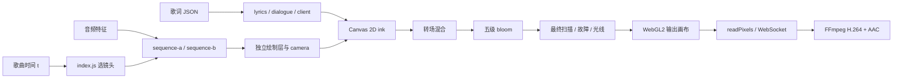

# 实现结构

本项目用原生 ES Module、Canvas 2D 和 WebGL2 绘制 PV，没有 React、视频编辑器工程或逐帧人物生成服务。运行时使用锁定 PNG 角色资产；界面、字形、数学图形、波形、线框、数据流与后期按歌曲时间计算。

## 时间坐标与镜头来源

公开渲染入口是 `src/nancy/index.js` 的 `init(canvas)` 和 `renderFrame(t, options)`。`t` 为歌曲秒数：`-5 ≤ t < 0` 是无声视觉片头，`0 ≤ t < 211.96` 是歌曲。帧不依赖此前播放到哪里。

| 模块 / 文件 | 实际职责 |
| --- | --- |
| `src/nancy/sequence-a.js` | 44 镜，0–125.65 秒：客户端建立、数学、参数、角色、猫爪与断连 |
| `src/nancy/sequence-b.js` | 45 镜，125.65–211.96 秒：权限拒绝、执行、计数、夺权与收束 |
| `src/nancy/index.js` | 合并 `SHOTS_A` / `SHOTS_B` 为 89 镜 `TIMELINE`，建立环境、分层绘制与转场 |
| `data/nancy_timeline.json` | 导出的时间表清单，供查阅；运行时不读取它来决定镜头 |
| `data/lyric-layout.json` | 不含文字的 129 行审核版布局；仅由本地 LRC 导入器在完整锚点匹配时使用，不由浏览器直接读取 |

调整镜头需要改 `sequence-a.js` / `sequence-b.js` 中的表和对应渲染函数，单独修改时间表 JSON 不会改变画面。主要段落在 29.42、59.223、74.19、103.73、125.65、148.04、162.81、192.34 秒发生变化；猫爪段是 82.04–85.04 秒。

每帧先按半开区间 `[start, end)` 找镜头。大多数动作用绝对时间归一化进度、缓动、固定哈希和音频采样生成；文字布局及角色分版会缓存，但缓存不保存“上一次播放进度”。同环境任意跳转应得到相同 Canvas 内容；硬件 WebGL 允许极小的舍入差异，检查值由关键帧工具记录。

## 绘制与合成路径

`index.js` 建立两个 1920×1080 Canvas 2D 缓冲：当前镜头 `ink`，以及转场用的 `other`。发生指定入场转场时，旧层取上一镜结束前的固定时间，新层按当前 `t` 绘制，然后交给混合着色器。`engine/transitions.js` 解析扫描、切片、对角、网格、窗口闭合等转场。

`src/nancy/reference-fx.js` 为上游 `src/engine/post.js` 提供冷蓝色与每帧参数。实际管线包含混合、五级泛光和最终后期；后期参数包括扫描线、暗角、颗粒、切片故障、局部 mosh、光束、水平光条和径向推近。色差、RGB 分离及反相在 NancyLu 适配层关闭。主要故障按短时包络出现，192.34 秒后收束。

`src/nancy/effects.js` 提供近黑、冰白、电蓝画布、网点、线框球与字符爆发。当前 NancyLu 配色定义在这里和角色分版模块；`config.json` 中保留的上游调色字段不等于本片所有颜色的统一开关。`ReferenceFX` 使用自己的默认后期配置。

## 角色资产与显影

`src/nancy/asset-character.js` 在初始化时解码六张姿势：胸像、侧脸、伸手、猫爪、眼部和男性胸像。`assets/nancy/master-v1.png` 用于身份参考，不参与实际加载。角色插画由 ImageGen 先制作并锁定，运行时不调用生成模型。

加载阶段把原图转为三墨版，并使用网点表示中间灰阶。虹膜区域有按姿势标定的椭圆遮罩，只将该处原蓝色映射为紫色 `#b46aef`。绘制层的正常皮肤源白墨固定为冰白 `#f2f5f7`，暗线与紫瞳不参与蓝色上色；蓝色源像素按头部、服装、外侧发梢 / 手套细节分三阶段由白到蓝。三阶段使用源墨色像素的实际形状及局部透明度，不用矩形块近似脸或躯干。最终后期仍会产生光学辉光。

同一分版还能按字符网格取样，并以原透明遮罩裁切成 `glyph` 版。`drawNancy` 支持姿势、位置、尺寸、透明度、字符显影进度和 `colorStage`。F → M 镜头采用无面女性派生与无面男性资产；其余正常角色保留紫瞳。

`src/nancy/avatar.js` 将用户像素头像存成颜色与行程数据，由矩形绘制，保留原色；它不通过角色的三墨转换。

## 客户端、歌词与逐字效果

| 模块 | 职责 |
| --- | --- |
| `src/nancy/client.js` | Codex 风格三栏布局、任务列表、代码面板、输入框、模型工具栏、Speed 与强度滑杆 |
| `src/nancy/dialogue.js` | 文字测量、换行、逐字符显隐和浮动对话窗；支持 type / decode / scan / rise / packet / glitch |
| `src/nancy/lyrics.js` | 加载 `data/lyrics-user.json`，查找当前行与近期上下文，向客户端正文或独立阅读区域绘制 USER / NancyLu 对话 |

浏览器读取的是有文字的 JSON，不直接解析 `media/lyrics-user.lrc`。`tools/prepare-lyrics.mjs` 将本地 LRC 转成该 JSON。它先合并重复时间点，再用完整的原始锚点列表匹配 `data/lyric-layout.json`：全部行数、每行起点和布局字段都合法且一致时，整套复用审核版 129 行的起止时间、USER / NancyLu 角色、效果与关键词标记。布局文件只含 `index`、`start`、`end`、`role`、`effect`、`keyword`，不含歌词文本。不会因局部锚点相同而只套用一部分布局。

没有完整匹配时，导入器采用通用规则：大写短关键词时长上限 0.55 秒，普通句上限 3.8 秒，结束时间还受下一行前 0.025 秒间隔限制；极短间隔保留正时长。角色与效果也按通用规则估计，输出 `layoutMatched:false` 及人工校准提示。两条路径均在匹配完成后叠加 LRC 毫秒 offset 与 CLI 秒 offset，再裁到 `0..end`。这使同版 LRC 可以复用审核布局，同时明确区分新 LRC 的估计结果。

工具还能生成不含原曲歌词的原创占位对话。启动用 `ensureDemoLyrics` 只在文件缺失时创建占位，任何已有文件都不被启动流程覆盖；显式导入可替换 demo，替换已有用户数据需 `--force`。每行需有开始、结束、文本和角色等信息；当前行通过绝对时间二分查找。句内进度按元音、辅音、空格和标点权重插值，因此“逐字”指显示机制，不能视作实测音素时间。

一般客户端镜头把歌词放入现有正文和输入框，避免再叠一套窗口。少数纯版画镜头在 `index.js` 的 `LYRIC_BOUNDS` 中保留明确阅读矩形；大关键词由对应场景单独绘制。

## 镜头运动

`src/nancy/camera.js` 的 `CAMERA_PLAN` 为 23 个选定镜头定义特写目标、倍率和裁切窗口。一般先停留半拍近景，至两拍进入中景，四拍内回到原构图；短镜头按时长缩短。

`index.js` 把人物、几何、背景和客户端包装成独立绘制层。数学镜头让曲线、切点与光标共享变换；控件镜头的配套图形使用同一坐标；NEW ORIGIN 的球体、坐标轴和 XYZ 共享镜头。阅读区保留原布局。相机变换作用于实际绘制，不是把完成帧复制成一张大图再缩放。

`cameraAt` 与 `drawCameraLayer` 都按 `t` 计算，可跳转检查。预览中的“减弱运镜”是显式选项；`?export=1` 固定完整方案，不读取系统动画偏好。`CAMERA_QA` 列出近、中、全景检查点。

## 音频与同步

`src/engine/features.js` 从 `data/audio_features.json` 采样 RMS、低中高频、频谱、拍点与 onset 包络。它通过插值和有限窗口峰值计算能量，不依赖实时麦克风或 WebAudio 分析。部分后期和镜头还使用固定的 130 BPM、约 0.344 秒首拍网格。`config.json` 的 `reactive` 参数被传入该采样器。

预览使用 HTML audio 时钟，画面歌曲时间为 `audio.currentTime + sourcePadding`。补偿值依次来自 URL `audio-offset`、`config.json` 的 `timing.audioSourcePadding`、内置默认值。缺少音乐时仍可拖动检查画面，播放按钮显示本地音轨提示，不启动无音频的假播放。参考制作 MP3 的补偿为 `1105 / 44100 ≈ 0.025056689` 秒；这个值来自其与参考特征音轨的测量。更换录音时需重新确认，不是从文件名推断。

离线导出范围为 `[start, end)`，第 `n` 帧的歌曲时间是 `start + n / fps`。音频处理为：

- 输入 seek：`max(0, start - audioOffset)`。
- 输出前导静音：`max(0, audioOffset - start)`。
- 音频重采样至 48kHz，按样本延迟、补齐并裁到整数视频帧时长。

所以全片 `start=-5` 时，视觉片头五秒，而该参考 MP3 起点约为文件 5.0250567 秒。总计 `ceil((211.96 + 5) × 60) = 13018` 帧、216.9667 秒。声源版本校准与“视频内部有没有漂移”是两个不同检查。

## 导出、服务器与验证

| 文件 | 实际职责 |
| --- | --- |
| `tools/nancy-server.mjs` | 启动 NancyLu 预览服务器并打印页面地址 |
| `tools/runtime.mjs` | 相对项目路径、真实路径入口判定、依赖、浏览器、FFmpeg 与跨平台 GPU 默认值的集中解析 |
| `tools/prepare-lyrics.mjs` | 本地 LRC 转换、完整锚点匹配时复用无文字布局、原创 demo 及现有用户数据保护 |
| `tools/doctor.mjs` | 只读检查本机运行条件、角色资产、歌词数据和音乐状态 |
| `export/server.mjs` | 依赖 Node 内置模块的本地静态服务器，支持音频 Range、WebSocket upgrade 和 `__nancy-status.json` 的音乐 / demo 状态 |
| `tools/render-nancy.mjs` | 独立无头浏览器，任意时间 / 六关键帧 / 全镜头 PNG，以及跳转复现检查 |
| `tools/export-nancy.mjs` | 按固定时间列表调用 `renderFrame`，WebGL RGBA 读取，经 WebSocket 逐帧推给 FFmpeg |
| `export/wsframes.mjs` | 帧大小检查与确认回包，配合 FFmpeg 写入回压限制在途帧 |
| `tools/verify-nancy.mjs` | MP4 样本表检查、严格完整解码、CFR / 色彩 / 帧数检查及源音频窗口相关性比对 |

`runtime.mjs` 优先使用项目 npm 依赖；仅在明确设置时读取 `NANCY_NODE_MODULES`。浏览器按显式路径、系统安装、Playwright 安装查找，FFmpeg 按显式路径、`toolchain/`、PATH 查找。GPU 的 `auto` 在 Windows 使用 D3D11，其他平台使用浏览器 default；可显式选择 SwiftShader。

`readPixels` 返回倒置的行顺序，FFmpeg 的 `vflip` 恢复方向。内核画布始终 1080p，输出尺寸改变时由 FFmpeg 缩放；没有逐帧 PNG 中间序列，也不使用个人浏览器配置。`--chunk` 是调用批次大小，当前每次导出只有一个渲染器。

默认产物在包内 `outputs/`，相对 `--out` 统一按包根解析。导出成功后才把 `.rendering.mp4` 更名为最终 MP4，并写 `.render.json`。验证器直接解析 MP4 的轨道与时间表，不要求 ffprobe；再调用 FFmpeg 严格解码。若 `.render.json` 中源音轨可读，则以四个 PCM 窗口验证输出相对该源音轨及偏移参数的同步，并检查片头静音。通过后写 `.verify.json`。

验证结果描述被检查的文件与环境；更换源文件、字体、浏览器或驱动后，应重新导出关键帧和短片。完整参数与操作步骤见 [USAGE.md](USAGE.md)。
